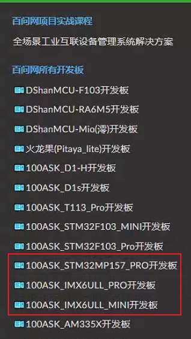

## 搭建环境

### 1. 使用百问网制作好的虚拟机

作为初学者，不要浪费时间在从0搭建环境上面。建议使用我们提供的虚拟机：

* 已经下载了开发板的开发包
* 已经安装好了各类软件，比如vscode、串口工具、adb工具

虚拟机下载方法：

* 打开：https://download.100ask.net/
* 在左侧找到这3款板子之一，点击后可以看到百度网盘链接，里面有目录"02_开发工具/100ask-vmware_ubuntu18.04"，下载它即可
  


### 2. 自己添加adb的支持

如果你使用的是自己制作的虚拟机，或者使用的是百问网提供的但是尚未安装所有软件的虚拟机，可以再Ubuntu中执行一下命令安装adb：

```shell
sudo apt install adb
sudo chmod a+x /usr/bin/adb
sudo chmod a+s /usr/bin/adb
sudo adb kill-server
```


### 3. 开发板

把adbd_files下的文件，全部复制到开发板根目录：

```shell
cd adbd_files
cp * / -rf

chmod +x /usr/bin/adb
chmod +x /usr/bin/adbd
chmod +x /usr/bin/usb_config
```


### 4. 使用adb

然后就可以在Ubuntu上使用adb操作开发板了：

```shell
adb devices
adb push 1.txt /root      # 把Ubuntu的文件放到开发板的/root目录
adb pull /root/1.txt 2.tx # 把开发板的/root/1.txt下载并改名为2.txt
adb shell                 # 登录开发板
```


